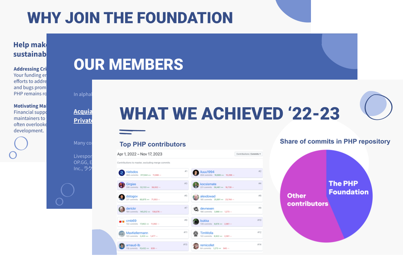

_Shape the future of the language ecosystem and help make PHP sustainable._

There are many ways you can support the development of the PHP language through&nbsp;The&nbsp;PHP&nbsp;Foundation:

* [Credit Card](https://opencollective.com/phpfoundation/contribute)
* [PayPal](https://opencollective.com/phpfoundation/contribute)
* [Bank Transfer (ACH direct debit or wire transfer)](https://opencollective.com/phpfoundation/contribute)
* [GitHub Sponsors](https://github.com/sponsors/ThePHPF)

All contributors will automatically receive a receipt for business expensing, and invoices can be sent upon [request](/contact). And all financial contributions that we receive, and our expenses, are [public and fully transparent](https://opencollective.com/phpfoundation#category-BUDGET). 

## Become a Company Member of The PHP Foundation

Are you looking to sponsor The PHP Foundation as a company? Become a member and earn additional benefits at the Silver, Gold, or Platinum levels.

Contact [contact@thephp.foundation](mailto:contact@thephp.foundation) to discuss your membership.
Or [sponsor directly](https://opencollective.com/phpfoundation) to become a member.



## Yearly and Monthly Sponsorships for The PHP Foundation

You can achieve Silver, Gold, or Platinum status by making financial contributions throughout the year. Contributions can be made annually, quarterly, or monthly.

- Once your contributions exceed a certain sponsorship level threshold, either through a one-time donation or cumulative monthly contributions, you immediately become a sponsor at that level.

- Sponsors are removed from the list at the end of each calendar year if their total contributions for that year do not meet the threshold for their level.

For example, if you contribute $1,500 monthly beginning in January, your total contribution by September will be $12,000, qualifying you as a Silver member for the _rest of the calendar year and the next_.

  

    <h2 id="membership-deck">Want to learn more?</h2>

    Read our annual Impact &amp; Transparency Reports for a detailed look  
    at what The PHP Foundation has accomplished and how funds are used.

    

      <a href="/blog/2026/05/27/impact-and-transparency-report-2025/" class="button-link">2025 Impact Report</a>
    

    

      Previous reports:
      <a href="/blog/2025/03/31/transparency-and-impact-report-2024/">2024</a> ·
      <a href="/blog/2024/02/26/transparency-and-impact-report-2023/">2023</a> ·
      <a href="/blog/2022/11/22/transparency-and-impact-report-2022/">2022</a>
    

  

  

    
  

## Official Info & Docs

The PHP Foundation operates under the umbrella of [OpenSourceCollective](https://www.oscollective.org/), and we rely on [OpenCollective](https://opencollective.com/phpfoundation) to receive and distribute funds.

Banking, taxes, legals:
[https://docs.oscollective.org/about/official-info-and-docs](https://docs.oscollective.org/about/official-info-and-docs)

* [Tax ID & W9](https://docs.oscollective.org/about/official-info-and-docs#tax-id-and-w9)
* [Address & Contact Info](https://docs.oscollective.org/about/official-info-and-docs#address-and-contact-info)

If you're experiencing any difficulties, require additional information, or would like to support the foundation in any other way, please don't hesitate to contact us at: [contact@thephp.foundation](mailto:contact@thephp.foundation).

